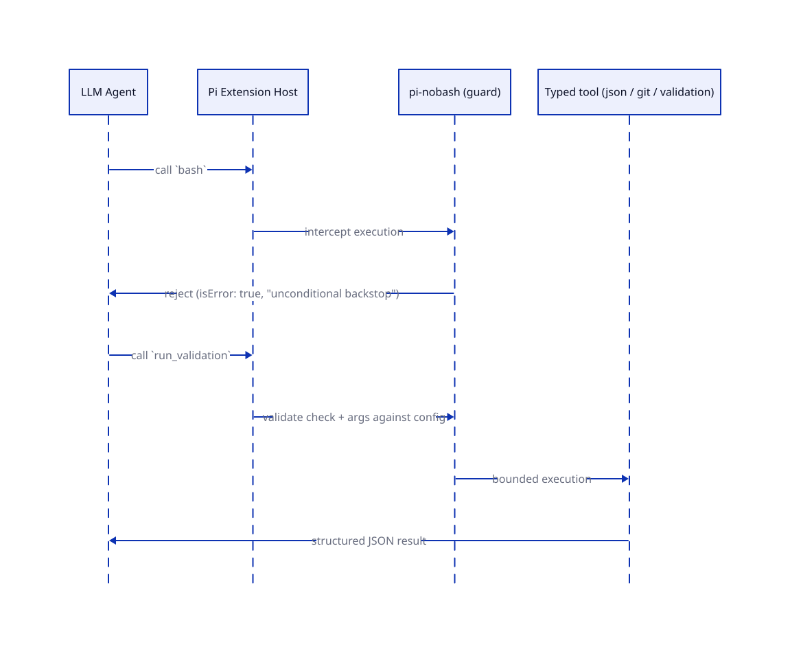

# Design decisions and tradeoffs

Part of [pi-nobash](https://github.com/afshinator/pi-nobash). This is the "why is it built
this way" record: architecture, the amendment-by-amendment tradeoffs, and the explicit
non-goals. Product requirements live in the repository's product specification.

## Architecture

```
Pi session
├── native selected tools        read / grep / find / ls / edit / write
└── pi-nobash extension          extensions/pi-nobash.ts
    ├── bash blocker             src/pi-guard.ts      (unconditional tool_call block)
    ├── /nobash-status           src/status.ts        (pure report builder + command)
    ├── json tools               src/json/            (operators, streaming, schemas)
    ├── git tools                src/git/             (rev validation, bounded exec)
    └── validation               src/validation/      (config, target, adapter, runner)
        shared: src/constants.ts, src/errors.ts, src/path-policy.ts
```

Layer rules: Pi's native tool selection is authoritative; packaged tools are inactive
until named; read-only and mutating capabilities are separate; trusted code owns
mechanics (parsers, fixed executables, argv); unsupported work returns
`CAPABILITY_GAP` rather than falling back to execution.

What a tool call looks like at runtime — a direct `bash` call is intercepted and refused
before execution, while a packaged tool is validated against its config and then run by its
own implementation:



How the pieces relate — the shipped core, the stack recipes in `docs/stacks/`, and the opt-in
companion extensions, plus the three levers that decide any one agent's toolset:


## Repository layout: `docs/stacks/` and `companions/`

Two directories cover the same territory and are often mistaken for duplicates. They are not:
they sit on opposite sides of the packaging boundary and hold different kinds of artifact.

| | `docs/stacks/` | `companions/` |
|---|---|---|
| Kind | prose guide (Markdown) | source code (TypeScript + tests) |
| Ships in the npm tarball | **no** (`docs/` is excluded) | **yes** (added to `files`, plan FD2) |
| Covers | all three levers — tool selection, `.pi/pi-nobash.json` checks, which extension to load — for TypeScript (Node + Expo), Python, Rust, Go | only the *mutation* tools, for TypeScript, Python, Expo |
| Audience | an adopter deciding what to configure | an adopter loading and running a companion |

Why both exist:

- **Prose vs source.** One is read; the other is loaded, type-checked, linted, and tested.
- **Shipped vs not.** The decisive reason. `docs/` never reaches an npm consumer, so anything a
  companion user needs *at install time* — load paths, the layout, the no-single-copy rule —
  must live under `companions/`, which is why `companions/README.md` repeats a little of the
  guide. The reverse is also true: a shipped file must not link relatively into `docs/`, which
  is why `companions/README.md` links the guide by absolute GitHub URL (enforced by
  `tests/unit/readme-links.test.ts`).
- **Coverage differs.** The guide spans stacks with no companions (Rust, Go) and non-mutation
  needs (read-only checks, native tools); `companions/` implements only mutating tools.
- **Lifecycle differs.** The guide predates the companions; the companions began as a README.

**The overlap to watch.** Both describe the same Git/formatter/dependency tools, and they drifted
once already (`switchToBranch` vs `switchTo`; an `all`/`-A` staging mode the plan excludes). The
rule that keeps them coherent: **`docs/stacks` says what and when; the plan and the source are the
single source of truth for schemas.** The A5/M4 pass replaces the guide's schema tables with
links to `companions/` and the plan rather than restating them.

Alternatives considered and rejected: folding the guides into `companions/*/README.md` (splits
the guide four ways, strands Rust/Go, and the shipped README already links to `docs/stacks/`);
renaming both for symmetry (cosmetic); dropping `companions/` and leaving every project to write
its own mutation tools (the pre-D2 world the companions exist to replace).


## Implementation decisions and tradeoffs

Each decision that is not in the original product or technical specification is recorded in
full, with rejected alternatives, in the [technical spec amendments](./pi-nobash-technical-spec-amendments.md)
(**A1–A14**). That document is the single source of truth for the amendment numbers; what
follows is a one-paragraph orientation, not a second copy.

- **A1–A3 — build, packaging, tooling.** No build step (Pi loads the `.ts` through `jiti`);
  host packages are `peerDependencies: "*"`; Biome and Fallow are dev-only, with a `files`
  allowlist that keeps dev tooling, tests, specs, and run state out of the npm tarball.
- **A4–A7 — data, errors, execution boundaries.** Typed JSON/JSONL operators with a fixed verb
  list (no query mini-language); `isError` error envelopes with a `"<CODE>: "` text prefix;
  Git revisions shape-checked then `rev-parse --verify`-confirmed; targeted validation only
  through the verified `node_test` adapter.
- **A8–A10 — verification and configuration.** Pi extension APIs are test-verified, not assumed
  from docs; under-specified shared contracts are frozen before work starts; `.pi/pi-nobash.json`
  is read once at session start and never re-read.
- **A11–A14 — registration and metadata.** Every tool carries a `promptSnippet` and accurate
  `readOnlyHint`; every tool is `defaultActive: false`; no `main`/`license`/`repository`; the
  entry path stays `./extensions/pi-nobash.ts`.

Additional contracts from the first implementation run:

- **Bootstrap interface:** `extensions/pi-nobash.ts` default-exports one factory that
  calls `registerBashBlocker`, `registerStatusCommand`, `registerJsonTools`,
  `registerGitTools`, `registerValidationTools`.
- **Naming and exposure:** every packaged tool is `exposure: "direct"`,
  `defaultActive: false`, snake_case, declares a TypeBox schema, and has no
  `command`/`argv`/`script` parameter (asserted by a schema-audit test).
- **No execution by composition:** there is no generic runner, `restricted_exec`,
  codemode path, or model-selectable executable anywhere in the model-facing surface.


## Limits and non-goals

- Not a sandbox, container, or host-security product; no isolation guarantee.
- No adversarial-jailbreak, prompt-injection, or containment claims.
- No general command/code execution fallback, and no interpreter or arbitrary query language.
- No universal control over third-party extensions; an agent given another generic
  runner is outside the intended configuration even if this package is loaded.
- `powershell` and `codemode` are excluded by tool selection and reported by
  diagnostics; unlike `bash`, they are **not** hard-blocked by this package.
- Optional Git mutations (`git_create_branch`, `git_add`, `git_commit`), typed file
  mutations, and format conversions are deliberately deferred and not implemented.
- The historical workload inventory's 411-vs-414 call-count discrepancy is
  unreconciled; no coverage percentage is claimed.
